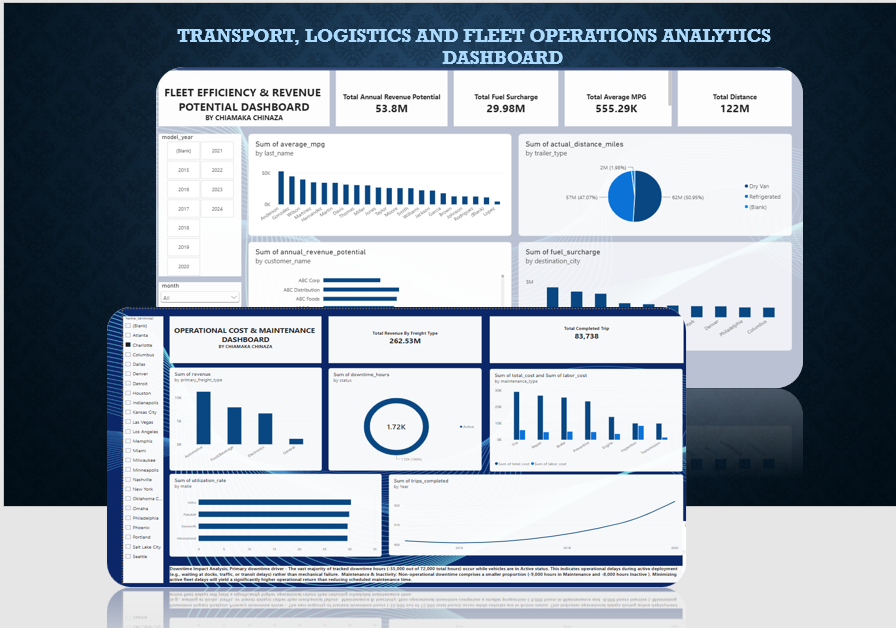
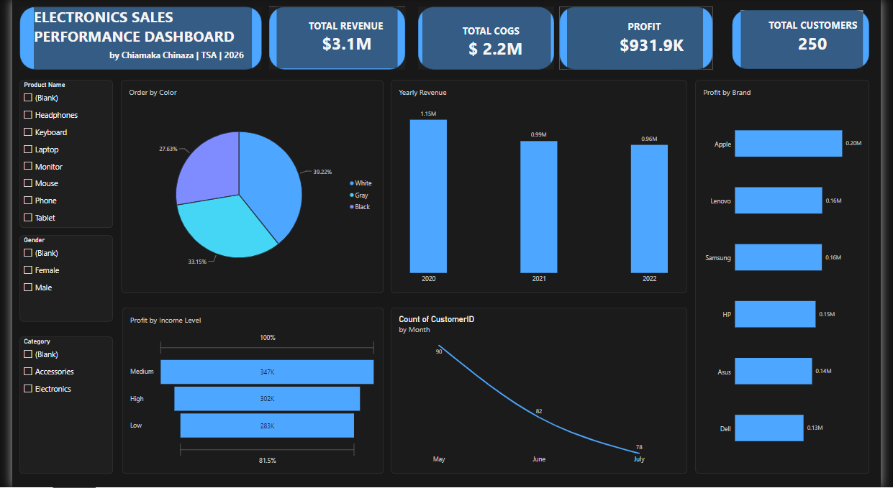
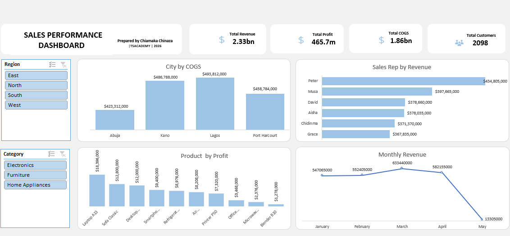

<!--Section 1: Introduce your self-->
## ABOUT ME

Hello! I'm Chiamaka Chinaza, AI Data Analyst, Seeking to leverage data-driven problem-solving skills for more accurate business decision making with Generative AI.

<!--Mention your top/relevant skills here - core and soft skills-->
## SKILLS

**- Data Analysis.**
I have hands-on skill in Data Cleaning and Preparation, Exploratory Data Analysis (EDA), KPI Reporting, Trend Analysis, Data Validation, Data Visualization and Driving Insights, Data-driven decision-making.

**- Tools.**
Microsoft Excel, SQL, Power BI

**- Machine Learning.**
Random Forest Classification and Regression, XGBoost, Prediction Probabilities and Model EValuation.

**- AI- Assisted Workflows.**
AI-Supported Research, Data Standardization, Prompt Design, AI Evaluation and Validation Of AI-Generated Outputs.

<!--Section 2: List 3-4 key projects-->
## MY PORTFOLIO 

*A glimpse of some of the projects I've been working on.*

**Research Integration Internship Project |Excelerate.**

I designed effective prompts, validate AI-generated content, and integrate AI into professional research and reporting workflows.

<a href= "Week4_Chiamaka Chinaza_Prompt Engineering_Combined_Deliverables.pdf">Download the Report here 4 (pdf file)</a>

<a href= "Week3_Chiamakachinaza_Research Validation matrix.pdf">Download the Report here 3 (pdf file)</a>

<a href= "Week2_Chiamaka Chinaza_Prompt Experimentation Report.pdf">Download the Report here 2 (pdf file)</a>

<a href= "Week1_Chiamaka Chinaza_Prompt Design LogBook.pdf">Download the Report here 1 (pdf file)</a>

**AI-powered Data Analysis Internship Project.**

How I used AI-powered decision-making, applied machine learning and time series analysis to forecast application peaks, identifying high-performing opportunities and presenting insights that support strategic planning.

<a href= "Week 4_ Chiamaka Chinaza_Final Presentation ^0 Insights Report(1).pdf">Download the Report here 4 (pdf file)</a>

<a href= "Week 3_Chiamaka Chinaza_Trained Models and Prediction Report.pdf">Download the Report here 3 (pdf file)</a>

<a href= "Week 2_Chiamaka Chinaza_Cohort Analysis Report With Visuals_Deliverables.pdf">Download the Report here 2 (pdf file)</a>

<a href= "Week1_Chiamaka Chinaza_Data Understanding Report_ Deliverables (1).pdf">Download the Report here 1 (pdf file)</a>

**Logistics and Fleet Operations Analytics Dashboard (Capstone Project).**

I built 2 interactive Transport, Logistics and Fleet Operations Analytics Dashboard which one of it deep-dives into trip volume, maintenance expenditure and a critical downtime analysis. 

[Read More](https://lnkd.in/p/eH4t4fd2)

**Electronics Sales Performance Dashboard (Power BI Project).**

I built an interactive dashboard, got my KPIs, income level and found the most profitable product.

[Read More](https://x.com/makalee7/status/2114500395368104050?s=46)

**Sales Performance Dashboard (Microsoft Excel).**

My first interactive Excel dashboard analyzing sales performance.

[Read More](https://x.com/makalee7/status/2114495351696552371?s=46)

## CONTACT DETAILS

*Let’s connect and see how we can make a difference together!*
<table>
  <tbody>
    <tr>
      <td>📧</td>
      <td><a href="mailto:chinazachiamaka8@gmail.com">chinazachiamaka8@gmail.com</a></td>
    </tr>
    <tr>
      <td>📞</td>
      <td>(234) 704-194-1522</td>
    </tr>
    <tr>
      <td>📍</td>
      <td>Abuja, Nigeria</td>
    </tr>
    <tr>
      <td>⬇️</td>
      <td><a href="https://mail.google.com/mail/u/0?ui=2&ik=8b2831a556&attid=0.1.1&permmsgid=msg-f:1879948967012073456&th=1a16eba0069dfff0&view=att&zw&disp=inline">Download my CV</a></td>
    </tr>
    <tr>
      <td>🌐</td>
      <td><a href="https://www.linkedin.com/in/chiamaka-chinaza-5950b9330">LinkedIn</a></td>
    </tr>
    <tr>
      <td>📺</td>
      <td><a href="https://x.com/makalee7/status/2114495351696552371?s=46">Check my progress on Twitter(X)</a></td>
    </tr>
  </tbody>
</table>

   

